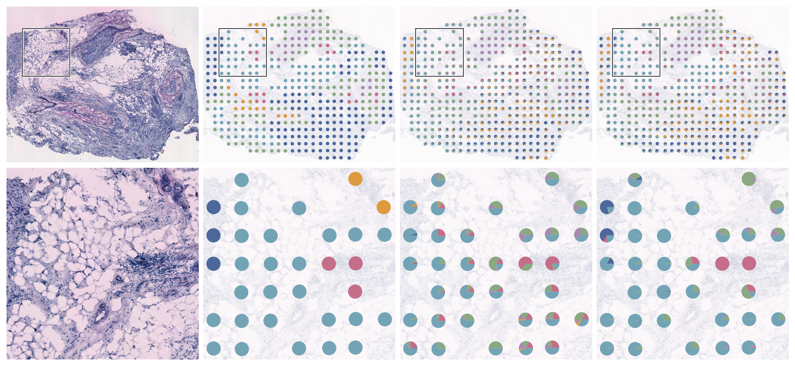

# spDecon

Spatial molecular deconvolution with learned or fixed profiles, histology guidance,
structured sample variation, and paired multi-omics measurements.

[Documentation](https://dsong-lab.github.io/spDecon/) ·
[Step-by-step tutorials](https://dsong-lab.github.io/spDecon/tutorial.html) ·
[Example data](https://github.com/dsong-lab/spDecon/releases/tag/tutorial-data-v0.1.0)

## The core model

spDecon represents each spot as a mixture of molecular components:
`Y ≈ diag(exposure) @ P @ B`. Here `P` contains spot weights and `B` contains
component profiles; both have unit row sums. The objective combines a
count-normalized Poisson/KL reconstruction loss with optional spatial total
variation and analysis-specific terms. The manuscript writes the profile matrix
as `C = B.T`.

Reference-free initialization fits three count-only branches, aligns their
profiles, and averages them equally before joint refinement. The same framework
supports fixed reference signatures, RNA–morphology reconstruction, nested
subject/condition profiles, and shared mixtures across paired assays. Molecular
weights describe signal contributions. Reference-based cell fractions additionally
use per-type reference yields.

## Six complete tutorials

Each notebook contains model explanations, input preparation, full fitting calls,
executed metric cells and figures. The website follows the
[spAlignDE tutorial format](https://dsong-lab.github.io/spAlignDE/tutorial.html).

| Workflow | Example and output | Notebook |
|---|---|---|
| **Reference-free** | Cerebellum: 1,000 pseudo-spots, correlation matrix and composition pie plots | [01](tutorials/01_reference_free.ipynb) |
| **Reference-based** | Xenium lymph node: fixed signatures, cell fractions and seven-group correlations | [02](tutorials/02_reference_based.ipynb) |
| **Histology-guided** | HER2ST G2: HIPT/UNI extraction, paired structure maps and quantitative improvement | [03](tutorials/03_histology.ipynb) |
| **Cross-modality comparison** | RCC: independently fitted RNA and protein structures in one comparison figure | [04](tutorials/04_cross_modality.ipynb) |
| **Joint multi-sample** | CRC: shared/patient/condition profiles and all 12 sections on the 480-gene panel | [05](tutorials/05_multisample.ipynb) |
| **Joint multi-omics** | Tonsil: shared RNA/protein weights and eleven spatial components | [06](tutorials/06_joint_multiomics.ipynb) |



The G2 plate shows H&E, pathology, RNA and RNA + H&E from left to right;
the lower row enlarges the outlined region.

## Public data sources

All six examples use public datasets. The links below identify the original
measurements and annotations; the [tutorial data release](https://github.com/dsong-lab/spDecon/releases/tag/tutorial-data-v0.1.0)
contains the processed inputs and saved spDecon results used by the notebooks.
Each notebook links its own sources and explains how to load inputs, fit the model
and regenerate its displayed results.

| Example | Original public sources |
|---|---|
| Cerebellum | [Slide-seq SCP354](https://singlecell.broadinstitute.org/single_cell/study/SCP354/slide-seq-study); [RETROFIT preparation scripts](https://github.com/qunhualilab/retrofit-scripts) and [archived benchmark](https://doi.org/10.5281/zenodo.19241634) |
| Xenium lymph node | [Xenium Prime target](https://www.10xgenomics.com/datasets/preview-data-xenium-prime-gene-expression); [Flex 320k scFFPE reference](https://www.10xgenomics.com/datasets/320k_scFFPE_16-plex_GEM-X_FLEX), library LNReactive_BC9-10 |
| HER2ST G2 | [HER2ST Zenodo deposit](https://zenodo.org/records/4751624): counts, H&E images, coordinates and pathology annotations |
| RCC | [Xenium Protein FFPE Human Renal Carcinoma](https://www.10xgenomics.com/datasets/xenium-protein-ffpe-human-renal-carcinoma) |
| CRC | [GEO GSE294385](https://www.ncbi.nlm.nih.gov/geo/query/acc.cgi?acc=GSE294385); [CRC_micromets_ST pathology and code](https://github.com/yliuup/CRC_micromets_ST) |
| Tonsil | [Visium CytAssist Human Tonsil Gene and Protein Expression](https://www.10xgenomics.com/datasets/visium-cytassist-gene-and-protein-expression-library-of-human-tonsil-with-add-on-antibodies-h-e-6-5-mm-ffpe-2-standard) |

## Installation

The verified numerical environment uses **Python 3.10.14, PyTorch 2.10.0 + CUDA
12.8, NumPy 1.26.4 and SciPy 1.13.1** on Linux x86_64. Reference-free training
uses an NVIDIA GPU. Saved-fit evaluation and tutorial plotting run on CPU.

```bash
git clone https://github.com/dsong-lab/spDecon.git
cd spDecon
python3.10 -m venv .venv
source .venv/bin/activate
unset PYTHONPATH
export PYTHONNOUSERSITE=1
python -m pip install -r requirements.lock.txt
python -m pip install --no-deps --no-build-isolation -e .
python -m pip install -r requirements-notebooks.txt
```

Alternatively use `conda env create -f environment.yml`, then install the package
and notebook requirements. Open `tutorials/*.ipynb` in Jupyter or VS Code with this
Python environment. Example data are downloaded automatically from the versioned
release on first use.

By default, `RUN_FIT=False` loads complete saved fits and recomputes metrics and
figures. Set it to `True` to run the complete fitting code. The CRC 12-section
result is archived and was not retrained for this release; its 480 genes are the
retained portion of the 500-gene candidate panel. No dataset is reduced for these
notebook outputs.

## Fitting progress and convergence

Full fitting prints initialization stages, periodic `objective` (loss) and KKT
residuals, followed by the iteration count, elapsed time and convergence status.
The final message distinguishes **converged** from **iteration limit reached;
not converged**. `objective` includes the active reconstruction and penalty terms;
KKT residuals and objective changes determine stopping. A lower loss alone does
not establish convergence or better biological accuracy.

The notebooks enable `VERBOSE=True`. Set it to `False` to suppress fitting logs;
Python fitting functions accept `verbose=False`. Core solver settings use
`SolverConfig(verbose=False)`. `log_every` controls printing frequency without
changing convergence checks or the optimization trajectory.

In the default `RUN_FIT=False` mode, notebooks explicitly identify the loaded
saved fit and show its recorded status, iteration count and final objective from
[training records](reproduction/training_summary.csv). No live training is
performed in that mode. With `RUN_FIT=True`, the messages report the new fit as it
runs. Full histories remain available as `fit.history` (or the `history` returned
by the strict fixed-reference solver).

## Run the reference-free core

Counts CSVs contain spots in rows and features in columns, with spot IDs in the
first column. Coordinates use the same IDs and `x,y` columns; an optional `block`
column identifies physical sections.

```bash
python run_spdecon.py core \
  --counts X.csv --coordinates coords.csv \
  --k 11 --seeds 1 3 5 --deterministic --output runs/example
```

This fits all three initializations, aligns profiles, and jointly refines the
consensus under KL + TV. The spatial coefficient is calibrated once from seed 1
unless specified explicitly. Output includes factors, optimization history,
settings and convergence diagnostics. Use raw nonnegative measurements and a new
output directory.

## Python interfaces

```python
from spDecon.reproducibility import set_seed
from spDecon.consensus import build_consensus
from spDecon.reference_spatial import fit as fit_fixed_reference
from spDecon.reference import fit_reference, fit_reference_consensus, cell_fractions
from spDecon.image_features import extract_histology
from spDecon.histology import fit_histology
from spDecon.multisample import fit_multisample
from spDecon.multiomics import fit_multiomics

set_seed(0, deterministic=True)
```

- **Reference-free:** `build_consensus` provides count-only initial factors;
  `spDecon.spatial.refine` fits the final spatial model.
- **Reference-based:** the strict main RNA recipe uses
  `fit_fixed_reference(..., tolerance=1e-10, max_steps=100000)` and spatial weight
  zero. `cell_fractions` performs reference-yield conversion. The separate ATAC
  reference protocol is available through `fit_reference_consensus`.
- **Histology:** `extract_histology` converts registered H&E into HIPT/UNI
  embeddings, PCA scores, visual-word dictionaries and 32-bin spot morphology.
  `fit_histology` shares spot weights between RNA and morphology, with image-gated
  spatial smoothing.
- **Joint multi-sample:** `fit_multisample` learns shared and subject-specific
  profiles. Use `group_by=['subject_id', 'condition']` and
  `subject_column='subject_id'` for nested condition effects. Graphs stay within
  sections. Both deviation penalties enter optimization.
- **Joint multi-omics:** `fit_multiomics` balances paired assays, learns one
  shared spot-weight matrix and couples explicitly linked features. It also
  supports fixed references with no learned modality-deviation penalty.
- **Independent cross-modality analysis:** run the core separately on each assay,
  then compare structures, as in RCC. This is distinct from joint fitting.

## HIPT and UNI image features

```bash
python -m pip install -r requirements-histology.lock.txt
git clone https://github.com/dsong-lab/spEnhance.git external/spEnhance
```

Obtain HIPT's `vit256_small_dino.pth` and `vit4k_xs_dino.pth` from the
[official HIPT release](https://github.com/mahmoodlab/HIPT), placing them in
`external/spEnhance/checkpoints/`. Request [UNI access](https://huggingface.co/MahmoodLab/UNI)
and authenticate locally. The [G2 notebook](tutorials/03_histology.ipynb) supplies
executable extraction code, image resolution, spot centers and capture radius.
Weights remain subject to their original terms and are not redistributed.

## Reproducibility and manuscript alignment

The preceding complete-data campaign finished 262 planned final fits and
independently recomputed their objectives. The tutorials use those full
reproductions, except for the explicitly archived CRC fit. All six notebooks have
executed outputs. The numerical locks include the initialization dependencies
that affected earlier environment reproducibility.

Results are close to the paper, with differences preserved in
[reproduction tables](reproduction/README.md). For example, RCC held-out PCC is
0.689139 in the ordinary full rerun versus 0.699004 archived; deterministic solver
replay gives 0.695808. These are not presented as identical results. Main RNA
fixed-reference settings are **100,000 steps / KKT 1e-10**, correcting the reviewed
draft's 3,000 / 1e-6 description for that specific protocol.

The multi-sample model includes the manuscript's five-cycle auxiliary profile
update. Its objective and that update were checked on the complete CRC dataset;
a new full 12-section training trajectory was not run. See
[model details](https://dsong-lab.github.io/spDecon/model.html) and
[reproduction scope](https://dsong-lab.github.io/spDecon/reproducibility.html).

## Build and publish the documentation

```bash
python3.10 -m venv .docs-venv
.docs-venv/bin/python -m pip install -r docs/requirements.txt
.docs-venv/bin/python tools/build_docs.py
```

The build renders saved notebook outputs using Sphinx and the Read the Docs theme.
The GitHub Actions documentation workflow publishes it to GitHub Pages.
Source data and third-party models retain their original attribution and terms;
see [data provenance](https://dsong-lab.github.io/spDecon/data.html).
