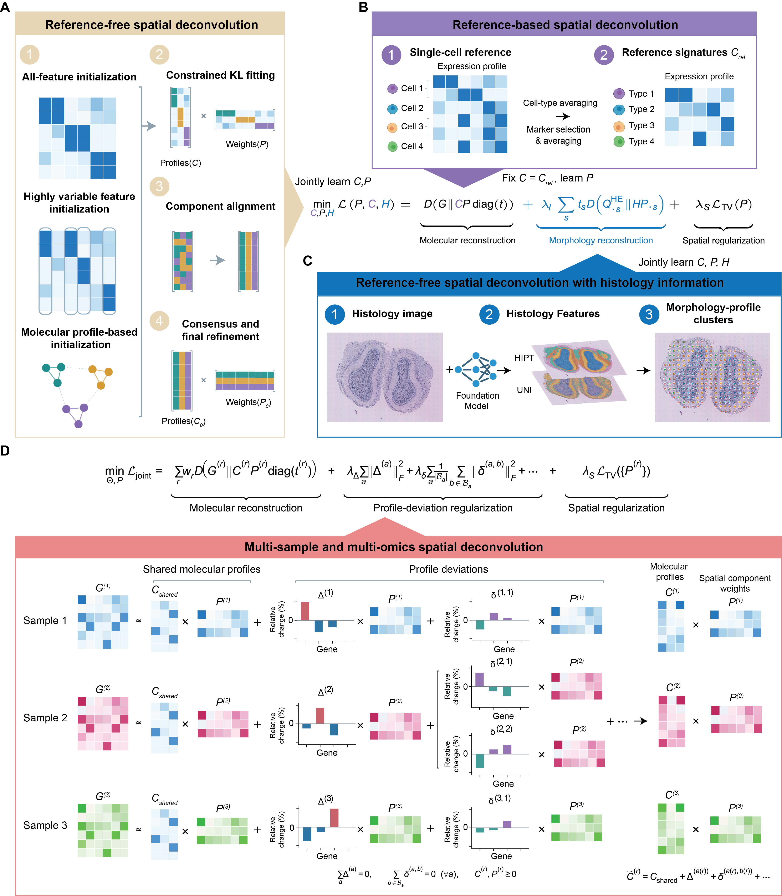

# spDecon

**spDecon** is a Python framework for spatial molecular deconvolution. It learns
component profiles and spatial mixtures, supports fixed references and histology
guidance, and jointly analyzes multiple samples or paired RNA–protein assays.
Its core model, `Y ≈ diag(exposure) @ P @ B`, combines Poisson/KL reconstruction
with spatial regularization.

[Documentation](https://dsong-lab.github.io/spDecon/) ·
[Tutorials](https://dsong-lab.github.io/spDecon/tutorial.html)

[](docs/source/_static/figures/Figure_1_decon.png)

## Installation

Use Python 3.10. Fitting supports CPU and NVIDIA GPU; the study's reference-free
and joint analyses used GPU acceleration.

```bash
git clone https://github.com/dsong-lab/spDecon.git
cd spDecon
python3.10 -m venv .venv
source .venv/bin/activate
unset PYTHONPATH
export PYTHONNOUSERSITE=1
# Choose one: GPU (CUDA 12.8) or CPU-only.
python -m pip install -r requirements.lock.txt       # GPU
# python -m pip install -r requirements-cpu.txt      # CPU
python -m pip install --no-deps --no-build-isolation -e .
python -m pip install -r requirements-notebooks.txt
```

See the [installation guide](https://dsong-lab.github.io/spDecon/installation.html)
for Conda and optional HIPT/UNI dependencies.

## Quick start

Run reference-free deconvolution on a counts CSV (spots × genes) and a coordinate
CSV (matching spot IDs with `x,y` columns). Both files use spot IDs in the first
column.

```bash
python run_spdecon.py core \
  --counts X.csv --coordinates coords.csv \
  --k 11 --device auto --seeds 1 3 5 --deterministic --output runs/example
```

`--device auto` uses CUDA when available and CPU otherwise. Select `--device cpu`
or `--device cuda` explicitly to choose the fitting device.

The output includes component weights, profiles and optimization history.
Fitting prints the current objective, KKT residuals and final convergence status.
See the [model](https://dsong-lab.github.io/spDecon/model.html) and
[Python API](https://dsong-lab.github.io/spDecon/api.html) for the other modes.

## Tutorials

The six notebooks use your own AnnData (`.h5ad`) files. Edit the input paths and
model settings, then run the loading, fitting and plotting cells. See the
[input guide](https://dsong-lab.github.io/spDecon/tutorial.html#anndata-input)
for the required counts, coordinates and metadata.

| Workflow | Notebook |
|---|---|
| Reference-free | [01](tutorials/01_reference_free.ipynb) |
| Reference-based | [02](tutorials/02_reference_based.ipynb) |
| Histology-guided | [03](tutorials/03_histology.ipynb) |
| Cross-modality | [04](tutorials/04_cross_modality.ipynb) |
| Joint multi-sample | [05](tutorials/05_multisample.ipynb) |
| Joint multi-omics | [06](tutorials/06_joint_multiomics.ipynb) |

The [H&E tutorial](tutorials/03_histology.ipynb) also covers extracting HIPT/UNI
embeddings and using the resulting morphology features in spDecon.

## License

[MIT License](LICENSE). Copyright © 2026 Su Xu.
Bundled third-party code retains its original license.
