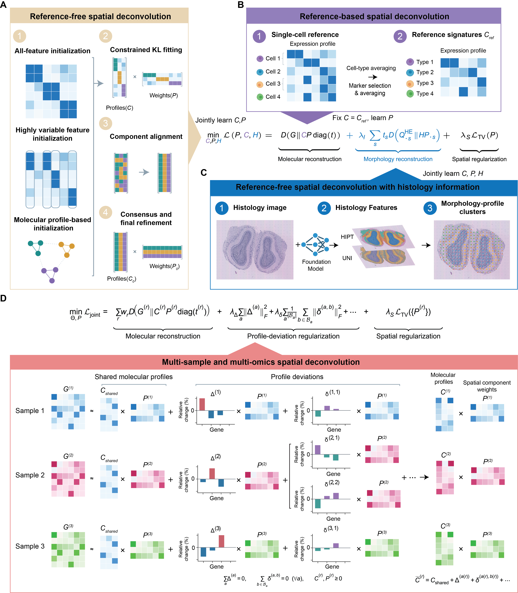

Overview
========

spDecon estimates spatial molecular mixtures across RNA, histology, samples and
paired assays. Use this page to choose an analysis.

.. container:: hero

   **Learn tissue components, estimate reference-defined mixtures, and compare
   spatial structure across measurements.**

   spDecon uses a common Poisson/KL factorization with simplex-constrained weights
   and profiles. Spatial regularization and task-specific terms extend the same
   model to histology, multiple samples and paired assays.

   Overview of spDecon. Click the figure to view it at full resolution.

Install and verify the environment with :doc:`installation`, then run your first
example in :doc:`quickstart`. For real inputs, follow :doc:`prepare_data` and one
of the six workflows in :doc:`tutorial`.

.. list-table:: Choose an analysis
   :header-rows: 1
   :widths: 25 43 32

   * - Analysis
     - Use when
     - Tutorial
   * - Reference-free
     - You have counts and want to learn components and their molecular profiles.
     - :doc:`Learn components <notebooks/01_reference_free>`
   * - Reference-based
     - You have annotated reference cells or signatures and want named type contributions.
     - :doc:`Use a fixed reference <notebooks/02_reference_based>`
   * - Histology-guided
     - You have registered H&E and want morphology to guide the RNA fit.
     - :doc:`Extract and integrate morphology <notebooks/03_histology>`
   * - Cross-modality comparison
     - You want to compare structures inferred separately from paired assays.
     - :doc:`Compare paired assays <notebooks/04_cross_modality>`
   * - Joint multi-sample
     - You have several sections and want shared profiles with sample or nested design effects.
     - :doc:`Choose named design effects <notebooks/05_multisample>`
   * - Joint multi-omics
     - You want paired assays to jointly estimate shared spatial component weights.
     - :doc:`Fit paired assays jointly <notebooks/06_joint_multiomics>`

Source code and notebooks:
`dsong-lab/spDecon <https://github.com/dsong-lab/spDecon>`_.
spDecon is released under the
`MIT License <https://github.com/dsong-lab/spDecon/blob/main/LICENSE>`_.

.. toctree::
   :hidden:
   :maxdepth: 2

   Overview <self>
   installation
   quickstart
   prepare_data
   tutorial
   model
   api
