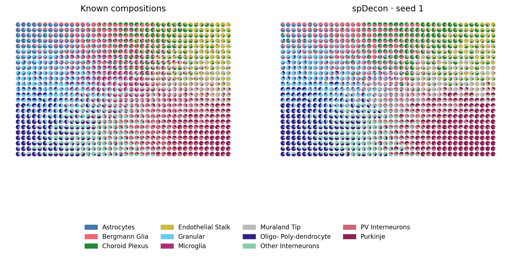
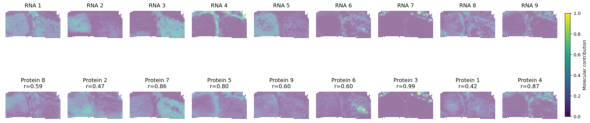

Tutorials
=========

spDecon estimates the molecular composition of spatial locations and the profiles
of their underlying components. Use reference-free fitting to learn components,
or a fixed reference to estimate contributions from named cell types. Histology
can guide spatial boundaries; joint models share information across tissue
sections or paired molecular assays. Cross-modality analysis instead fits each
assay independently and compares the resulting structures.

This page explains how to prepare inputs and choose a function after reading
:doc:`model`. The six notebooks use **AnnData as the common data container**,
then pass its count matrix, coordinates and metadata to the numerical functions.
See :doc:`api` for function parameters and return values.

.. list-table:: Worked examples
   :header-rows: 1
   :widths: 24 43 33

   * - Workflow
     - Read guide and outputs
     - Run notebook
   * - Reference-free
     - :doc:`Cerebellum: correlations and spatial pies <notebooks/01_reference_free>`
     - `01_reference_free.ipynb <https://github.com/dsong-lab/spDecon/blob/main/tutorials/01_reference_free.ipynb>`_
   * - Reference-based
     - :doc:`Xenium lymph node: fixed signatures and cell fractions <notebooks/02_reference_based>`
     - `02_reference_based.ipynb <https://github.com/dsong-lab/spDecon/blob/main/tutorials/02_reference_based.ipynb>`_
   * - Histology
     - :doc:`G2: HIPT/UNI extraction and paired improvement <notebooks/03_histology>`
     - `03_histology.ipynb <https://github.com/dsong-lab/spDecon/blob/main/tutorials/03_histology.ipynb>`_
   * - Cross-modality
     - :doc:`RCC: independent RNA/protein structures <notebooks/04_cross_modality>`
     - `04_cross_modality.ipynb <https://github.com/dsong-lab/spDecon/blob/main/tutorials/04_cross_modality.ipynb>`_
   * - Joint multi-sample
     - :doc:`CRC: 480 genes, 12 sections and nested profiles <notebooks/05_multisample>`
     - `05_multisample.ipynb <https://github.com/dsong-lab/spDecon/blob/main/tutorials/05_multisample.ipynb>`_
   * - Joint multi-omics
     - :doc:`Tonsil: paired RNA/protein spatial structure <notebooks/06_joint_multiomics>`
     - `06_joint_multiomics.ipynb <https://github.com/dsong-lab/spDecon/blob/main/tutorials/06_joint_multiomics.ipynb>`_

.. _anndata-input:

Prepare input data with AnnData
-------------------------------

Use one ``AnnData`` object per assay, with **spatial locations in rows and
features in columns**. A location may be a measured capture spot or a constructed
pseudo-spot. Keep unique spot and feature IDs. The conventions below apply to all
six notebooks; ``N`` denotes locations and ``G`` denotes features.

.. list-table:: Input fields
   :header-rows: 1
   :widths: 32 18 50

   * - Field
     - Shape
     - Contents
   * - ``adata.X``
     - ``N × G``
     - Raw counts, or the explicitly prepared nonnegative assay measurements
       described in the notebook. Each location needs positive total signal.
   * - ``adata.obs_names`` / ``adata.var_names``
     - ``N`` / ``G``
     - Spot IDs / gene or protein names, in matrix order.
   * - ``adata.obsm["spatial"]``
     - ``N × 2``
     - Spatial coordinates used to construct the graph, in a common coordinate
       system within each section.
   * - ``adata.obs["section_id"]``
     - ``N``
     - Physical section IDs; graph edges stay within sections. A single section
       can use the same ID for every spot.
   * - ``adata.obs["subject_id"]``, ``adata.obs["condition"]``
     - ``N`` each
     - Patient and condition labels for the nested multi-sample model.
   * - ``adata.obsm["morphology"]``
     - ``N × 32``
     - Histology only: HIPT and UNI visual-word frequencies. Each 16-column
       block sums to 0.5. These are derived features, not the raw embeddings.

**Read an existing file:**

.. code-block:: python

   import anndata as ad
   import numpy as np

   adata = ad.read_h5ad("sample.h5ad")
   counts = adata.to_df()  # labeled spots × features, from adata.X
   y = np.array(counts, dtype=float, order="F")
   xy = adata.obsm["spatial"]

If ``X`` contains normalized or log-transformed RNA, use a stored raw-count
layer instead: ``counts = adata.to_df(layer="counts")``. Do not pass log expression
to the fitting functions. ``to_df`` also converts a sparse matrix to a dense
DataFrame, preserving its spot and feature order; fitting requires memory for
the dense matrix. See the `AnnData conversion documentation
<https://anndata.readthedocs.io/en/stable/generated/anndata.AnnData.to_df.html>`_.

**Create an object from CSV files:** ``counts.csv`` has spot IDs in its first
column and genes in the remaining columns; ``coordinates.csv`` has spot IDs
and ``x,y`` columns.

.. code-block:: python

   import pandas as pd

   counts = pd.read_csv("counts.csv", index_col=0)
   coordinates = pd.read_csv("coordinates.csv", index_col=0).loc[counts.index]
   adata = ad.AnnData(counts)
   adata.obsm["spatial"] = coordinates[["x", "y"]].to_numpy()
   adata.obs["section_id"] = "section_1"
   adata.write_h5ad("sample.h5ad")

Additional inputs depend on the workflow:

* **Fixed reference:** use a second AnnData object whose rows are cell types
  and columns are genes. Its values are arithmetic mean raw counts per cell type.
  Select the marker panel and align gene order before extracting matrices:
  ``reference_adata = reference_adata[:, adata.var_names].copy()``. The Xenium
  notebook shows the reference table and the conversion to cell fractions.
* **Histology:** provide a registered H&E image and spot centers in original image
  pixels to ``extract_histology``. Store its aligned output in
  ``adata.obsm["morphology"]``. Image-pixel coordinates can be stored separately
  in ``adata.obsm["spatial_image"]``; do not substitute array-grid coordinates
  when extracting image patches. The G2 notebook includes both encoder steps.
* **Multiple sections:** concatenate sections along the observation axis, using
  a common gene panel and unique spot IDs. Store section, subject and condition
  labels in ``adata.obs``; pass that table as ``metadata``.
* **Paired assays:** keep a dictionary such as
  ``assays = {"RNA": rna_adata, "protein": protein_adata}``. Objects share
  identical spot IDs in identical order but may have different feature panels.
  Align protein rows with ``protein_adata = protein_adata[rna_adata.obs_names].copy()``
  before constructing the dictionary. ``links`` identifies corresponding
  RNA/protein features; unmatched features remain in the model.

From AnnData to a fit
---------------------

The numerical functions accept NumPy arrays or labeled DataFrames. AnnData keeps
the inputs together; the conversion is explicit in each notebook. For example,
the reference-free workflow learns a three-branch consensus and then jointly
refines its weights and profiles using the spatial graph:

.. code-block:: python

   from spDecon.reproducibility import set_seed
   from spDecon.consensus import build_consensus
   from spDecon.spatial import spatial_graph, calibrate, refine

   set_seed(1, deterministic=True)
   y = np.array(counts, dtype=float, order="F")  # raw matrix selected above
   initial = build_consensus(y, n_components=11, random_state=1)
   i, j, w, graph_info = spatial_graph(
       adata.obsm["spatial"], adata.obs["section_id"].to_numpy())
   calibration = calibrate(
       y, initial.consensus_proportions, initial.consensus_profiles, i, j, w)
   result = refine(
       y, initial.consensus_proportions, initial.consensus_profiles,
       i, j, w, strength=calibration["spatial_weight"], seed=1)

``n_components`` selects the number of latent components; choose it for your
dataset (11 is the Cerebellum example). ``random_state`` controls initialization.
``strength`` controls spatial smoothing; here it is calibrated from the seed-1
consensus. Reference-free training uses the CUDA environment. Function-specific
arguments, convergence controls and other workflows are described in :doc:`api`.

For a single-assay fit, store the result alongside the input:

.. code-block:: python

   adata.obsm["spDecon"] = result.proportions     # N × K molecular weights
   adata.varm["spDecon_profiles"] = result.profiles.T  # G × K
   adata.uns["spDecon_components"] = [
       f"C{k+1}" for k in range(result.proportions.shape[1])]
   adata.write_h5ad("sample_spdecon.h5ad")

Rows of the molecular weights sum to one. Reference-based cell fractions are
stored separately as ``adata.obsm["spDecon_cell_fractions"]``. Multi-sample
profiles and concatenated multi-omics profiles have different shapes; see their
return-value descriptions in :doc:`api` and the corresponding notebooks.

How to use the examples
-----------------------

1. Follow :doc:`installation` and open a notebook with that Python environment.
2. Run the setup and loading cells. The versioned data bundle is downloaded once.
3. Keep ``RUN_FIT=False`` to inspect the complete saved fit, or set it to ``True``
   to retrain using the full dataset and recorded optimization limits.
4. Run the metric and plot cells. Tables and fitted-weight exports go to
   ``outputs/``; PNG figures are also written to ``docs/source/_static/figures``.

The notebooks never use evaluation labels for model fitting. Matching components
to known labels is explicitly performed after fitting. The CRC notebook uses the
archived full 12-section result; it does not report a new full retraining.

